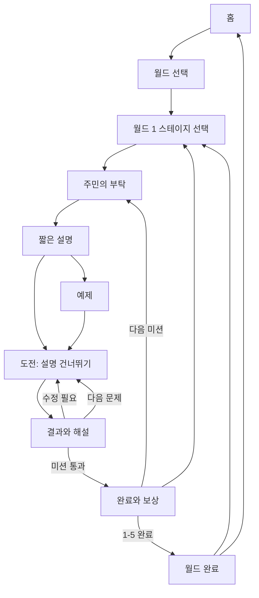

# 화면과 운영

[전체 기획안](기획안.md) · 관련 문서: [게임과 보상](게임과보상.md), [기술과 검증](기술과검증.md)

## 문서 상태

결정은 사용자님이 동의한 방향, 초안은 검토 중인 기존 구상, 미정은 후속 논의 항목입니다. 디자이너 관점의 검토는 아직 진행하지 않았습니다.

## 화면 구성 — 초안

최신 수행형 활동에는 정보 질문·자료 서랍·문서 편집·주장/근거 연결·흐름 구성/시험·대안 비교/계획 패널이 필요합니다. [수행형 활동과 검토](수행형활동과검토.md)의 단계별 패널 구상으로 관리하고 기존 정적 시안은 외형 참고로 유지합니다. 실제 새 화면 설계·조작 검증은 남아 있습니다.

실제 배치할 배경·캐릭터와 HTML/CSS UI의 구분은 [화면 자산 목록](화면자산목록.md)에서 관리합니다. 공통 마을 배경, 주민 5명 기본 이미지와 고드래곤 4개 원본 사본을 준비했으며 실제 합성 검증은 남아 있습니다.

스테이지의 활동 화면은 [스테이지 유형과 화면](스테이지유형과화면.md)에서 OX·선택·카드 분류·자료 비교·직접 대화로 구분해 검토합니다. 이야기 대화화면과 직접 입력 대화 활동은 서로 다른 화면입니다.

### 월드 선택 이미지 시안 v1

[고디월드 월드 선택 시안](시안/고디월드-월드선택-v1.png)

- 제공된 고드래곤의 대표 이미지 8개를 시각적으로 확인하고 정면·방가·시그니처 이미지 3개를 생성 참조로 사용했습니다.
- 민트색 캐릭터, 크림색 패널, 햇살과 초록 풍경, 둥근 모형 같은 입체감으로 따뜻한 판타지를 표현했습니다.
- 지도에 여섯 지역 선택 지점을 두고 오른쪽에 선택 월드 설명과 ‘스테이지 보기’를 배치했습니다. 시작의 마을 외 지역은 준비 중 상태의 잠금 표시 후보입니다.
- 캐릭터와 배경은 AI가 생성한 시안입니다. 실제 구현에서는 제공된 캐릭터 원본 사용과 배경·텍스트·버튼 분리를 검토합니다.
- 이미지의 진행 수치는 예시입니다. 자유 이동·공식 UI 결정·소스코드 구현을 뜻하지 않습니다. 한국어 표기와 배치, 작은 화면 가독성은 실제 화면 제작 시 재검토합니다.

업무 화면의 명료함과 캐주얼 게임의 생동감을 결합합니다. 정확한 배치·색상·스타일은 미정입니다.

| 화면 | 주요 내용 |
| --- | --- |
| 게임 홈 | 고드래곤, 현재 레벨·보상, 이어하기, 미니게임 자리, 학습 리포트 |
| 월드 지도 | 월드 경로와 완료·진행 중·잠김 상태, 복습 진입 |
| 미션 | 상황과 목표, 짧은 설명·예제, 문제와 선택, 무료 상세 해설 다시 보기, 힌트 |
| 결과·보상 | 선택의 이유와 결과, 다음 행동, 축하 표현, 확정된 보상 |
| 학습 리포트 | 연습한 영역, 완료 미션, 복습할 내용 |

첫 시제품의 실제 플레이 범위는 월드 1의 5개 미션입니다. 다른 월드의 표시와 리포트·상점 등 보조 화면의 구현 범위는 미정입니다. 미니게임 자리에서는 게임이 이미 제공되는 것처럼 안내하지 않도록 문구를 정합니다.

## 월드 1 화면 흐름 — 검토 초안

### 시작의 마을 스테이지 선택 시안 v1

[시작의 마을 화면 시안](시안/시작의마을-스테이지선택-v1.png)

- 월드 선택 시안과 같은 둥근 입체감·민트·크림색으로 마을 장터와 고드래곤을 표현했습니다.
- 오른쪽에 다섯 스테이지를 표시하고 1-1만 시작 가능, 나머지는 잠김인 첫 진입 상태를 제안했습니다. 위쪽에는 월드 선택으로 돌아가기와 완료 수를 배치했습니다.
- 시각 검토용 이미지입니다. 버튼 동작·반응형 화면은 구현 전이며 진행 수치는 예시입니다.

**결정**: 월드 선택 → 스테이지 선택 → 주민의 부탁 → 설명·예제 → 도전 → 해설·재도전 → 완료로 진행합니다. 주민의 부탁은 초상화와 짧은 대사로 표현하는 도입이며 자유 이동·별도 퀘스트 수락과 관리는 현재 시제품 범위에 넣지 않습니다. 공통 화면에 스테이지별 대사·자료·문제를 바꿉니다.

**결정**: 사용자가 게임 내 이름을 직접 정하며 길이는 7자 이내입니다. 이름 입력 화면의 위치, 입력 안내, 초과 입력 처리와 저장 방식은 미정입니다. 현재 흐름도에는 이름 입력 단계의 위치를 확정하지 않았습니다.

연결되는 사건과 대사는 [시나리오](시나리오.md)에서 관리합니다. 아래 배치·버튼·전환은 검토용이며 최종 구현 범위가 아닙니다.

자동 판정과 무관하게 정답자·오답자 모두 해설을 볼 수 있도록 합니다. 전체 통과 조건을 충족하기 전에는 미션 완료 화면으로 전환하지 않습니다.

### 화면별 요소와 동작

| 화면 | 위쪽 | 중심 내용 | 주요 버튼·전환 |
| --- | --- | --- | --- |
| 홈 | 게임 이름 | 고드래곤, 시작·진행 안내, 미니게임 자리 | 처음 시작/이어하기 → 월드 또는 복원 지점 |
| 월드 1 | 월드 이름·완료 수 | 다섯 스테이지 버튼·카드 | 열린 스테이지 시작, 완료 스테이지 복습, 홈 |
| 상황 소개 | 미션 이름·목표 | 주민 초상화·짧은 부탁, 고드래곤 안내 | 설명 보기, 도전으로 이동 후보 |
| 설명 | 현재 단계 | 짧은 개념·작동 사례 | 예제 보기, 설명 건너뛰기 |
| 예제 | 목표와 단계 | 예시와 선택 이유 | 도전 시작, 설명 다시 보기 |
| 도전 | 미션·문제 진행 | 업무 자료와 선택지 | 선택 후 제출, 힌트, 설명 보기, 나가기 |
| 해설 | 선택 결과 | 선택한 답의 이유, 근거, 다음 행동 | 다시 선택/다음 문제/미션 완료로 이동 |
| 완료·보상 | 완료 표시 | 주민의 감사·고드래곤 반응, 그림 변화 후보, 확정 보상 | 다음 스테이지, 무료 해설 다시 보기, 목록으로 |
| 월드 완료 | 월드 1 완료 | 연습한 내용, 복습 안내 | 복습하기, 홈으로 |

상황·설명·예제는 하나의 미션 화면 안에서 단계별로 전환하는 안입니다. 각각 별도 페이지로 구현할지는 기술 결정 이후 정합니다. 1-5 완료 후에는 다음 미션 대신 월드 완료로 이동합니다.

### 도전 화면의 배치 제안

- 위쪽: 미션명, 목표, 현재 문제 번호. 제한시간은 표시하지 않는 안입니다.
- 중심: 자료·문제와 선택지. 고드래곤 안내는 문제를 가리지 않는 영역에 배치합니다.
- 아래쪽: 주 행동인 제출 버튼과 설명·힌트 보기. 선택 전 제출은 비활성화하고 필요한 조작을 안내하는 안입니다.
- 해설: 결과 확인 후 같은 화면에 이유와 다음 행동을 표시합니다. 색만으로 정오답을 구분하지 않습니다.
- 카드 배열·연결: 드래그와 함께 클릭·키보드 조작 방법을 검토합니다.

### 미니게임 자리와 중단 상태

- 미니게임은 ‘준비 중’ 안내 자리만 제공하는 안입니다. 개수·위치는 미정이며 아직 플레이나 코인 획득이 가능하다고 표시하지 않습니다.
- 나가기 이후 복원 지점은 저장 범위 결정에 따릅니다. 미저장 선택이 있다면 나가기 전 알리는 방안을 검토합니다.
- 처음 시작, 진행 중, 미션 완료, 월드 완료 상태에 따라 홈의 안내와 버튼을 구분합니다.
- 상점·전체 리포트·다른 월드 화면은 이번 화면 흐름의 필수 항목으로 확정하지 않습니다.

### 다음 검토

배치·문구·고드래곤 공간 변화, 대상 기기, 설명 건너뛰기와 복습 동작을 사용자님과 검토합니다. 색상·그림·애니메이션의 구체적 스타일과 디자이너 검토는 이후 진행합니다.

## 고드래곤의 역할 — 초안

### 대화화면 시안 v1

[고드래곤과 나래의 대화화면](시안/시작의마을-대화화면-v1.png)

- 시작의 마을 배경, 왼쪽 고드래곤·오른쪽 안내인 나래, 아래 이름표·대사·다음 버튼을 배치했습니다.
- 위쪽에는 스테이지 선택으로 돌아가기와 대화 건너뛰기를 제안했습니다. 대화의 마지막에는 설명 화면으로 이어지는 동작을 추후 정합니다.
- 나래는 갈색 머리·살구색 옷·초록 망토·안내 책자를 가진 주민 외형 후보입니다. 성별·외형·표정은 확정 전입니다.
- 주민 5명과 고드래곤이 대화 캐릭터 후보이며 한 화면에는 1~2명 배치를 제안합니다. 현재 발화자 강조·대화창 위치·원본 캐릭터 활용은 구현 시 정교화해야 합니다.
- 정적 이미지 시안이며 캐릭터 개별 파일, 표정 세트와 대화 기능을 구현한 결과가 아닙니다.

- 목표와 임무를 알려주는 안내자.
- 실수의 이유와 단서를 설명하는 코치.
- 성공과 성장을 축하하는 동료.
- 월드 완료와 다음 사건을 연결하는 진행자.

기본·기쁨·고민·응원·축하의 다섯 표정과 간단한 동작은 기존 제작 후보입니다. 캐릭터 원본과 사용 권한은 확보 여부가 미확인입니다. 공식 캐릭터 사용을 전제로 확정하지 않습니다.

## 이어하기와 접근성

**결정**: 업무 중 중단 후 돌아오는 경험을 설계하고 드래그 외 클릭·키보드 조작도 고려합니다. 목표 기기와 실제 접속 환경을 확인합니다.

**미정**: 미션 중 선택, 완료 단계, 설명 열람, 힌트 상태의 저장 범위와 저장 시점, 다른 기기에서의 이어하기 여부. 완료 미션과 보유 보상을 유지하는 것은 기존 초안입니다.

**초안 검증 항목**: 키보드 조작, 글자 확대, 색상 대비, 조작 상태 안내, 주요 브라우저 호환성.

## 학습 리포트

**결정**: 게임에서 연습한 영역과 복습할 내용을 보여줍니다. 별도 사전·사후 진단은 추가하지 않으며 실제 직무역량을 정밀 측정한 것처럼 표현하지 않습니다.

**초안 표시 후보**:

- 완료 미션 수와 월드 진행 상태.
- 보유 XP·배지 등 게임 성장 기록.
- 영역별 연습 내용과 보완할 판단.
- 다시 살펴볼 미션과 추천 이유.

예: “숫자의 근거를 확인하는 연습을 하셨습니다. 다음에는 분모와 집계 기준을 함께 살펴보세요.” 이는 안내 문구 예시이며 확정 대사가 아닙니다.

기존 18/30 완료, 1,800 XP, 배지 3개 예시는 실제 데이터가 아닙니다. 월드 완료 보너스 적용 여부에 따라 XP도 달라지므로 화면 확정값으로 사용하지 않습니다.

기존 역량 가중합 점수는 참고 초안입니다. 영역별 값은 `100 × Σ(문항의 영역 가중치 × 획득점수 비율) / Σ(영역 가중치)`로 계산하는 안이었습니다. 3-5의 검증 60%·실무 25%·지식 15%도 검증된 가중치가 아닙니다. 미응시는 ‘평가 전’ 또는 ‘아직 연습하지 않음’으로 표시하는 안을 유지하며, 점수·신뢰도 표시 여부와 산정 방식은 미정입니다.

## 이수와 최종 미션 — 기존 초안과 미정

| 항목 | 현재 취급 |
| --- | --- |
| 월드 완료 | 5개 미션 모두 통과하는 기존 초안 |
| 전체 과정 완료 | 전체 확장 후 30개 필수 미션 통과하는 기존 초안 |
| 6-5 | 연결된 업무 사건을 해결하는 종합 미션 초안 |
| 최종 판정 | 필수 위험관리 조건 및 종합 80점 기준은 재검토할 초안 |
| 우수 이수 | 별도 평가 90점 기준은 채택하지 않은 기존 안이며 미정 |
| 미니게임 | 필수 이수 조건에서 제외하는 기존 초안 |
| 이수 기록 | 이용자, 완료 시각, 콘텐츠 버전, 최종 판정 저장 초안 |

별도 진단을 넣지 않기로 했다고 이수 기능 전체를 폐지한 것은 아닙니다. 게임의 완료 표시와 기관의 공식 교육 이수 인정은 구분합니다. 공식 이수 운영 여부·기준·학습시간 인정은 교육운영 담당자와 확인해야 할 미정 항목입니다. 첫 시제품이 공식 이수 체계를 제공한다고 가정하지 않습니다.

## 관리자 기능 — 향후 운영 초안

- 교육 대상과 운영 기간, 공지 관리.
- 문제·정답 조건·힌트·콘텐츠 버전 관리.
- 참여·시작·완료 인원과 이수 현황.
- 미션별 성공률, 도전 수, 힌트 이용, 중도 이탈, 접속 오류.
- 영역별 학습 기록과 오답 집중 문항.
- 개인 조회와 조직 집계의 권한 구분, 이수 결과 CSV 내보내기.

개인 성장을 지원하고 공개 순위 경쟁은 우선하지 않는 기존 방향을 유지합니다. 운영관리자·교육담당자·학습자 권한 분리는 초안입니다. 응답·로그 수집 목적과 최소 범위, 보존 기간, 첫 시제품 포함 여부는 미정입니다. 사전·사후 점수 변화는 현재 리포트·관리자 지표에서 제외합니다.

